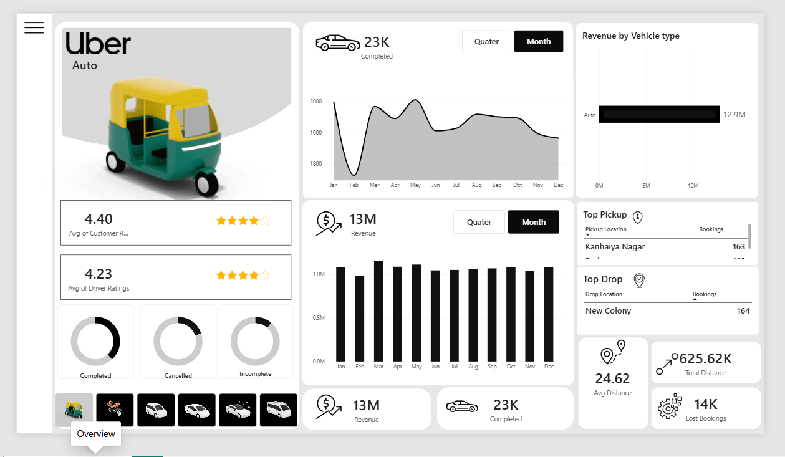
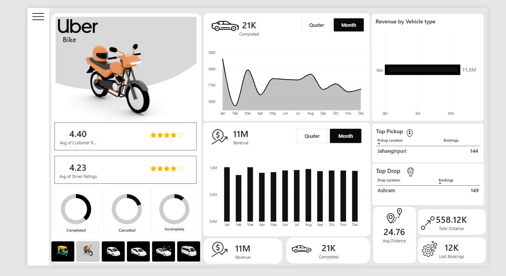
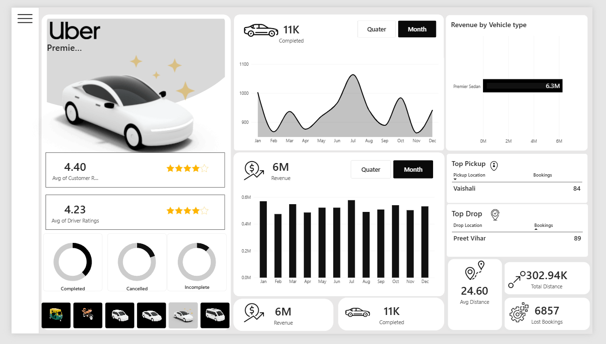
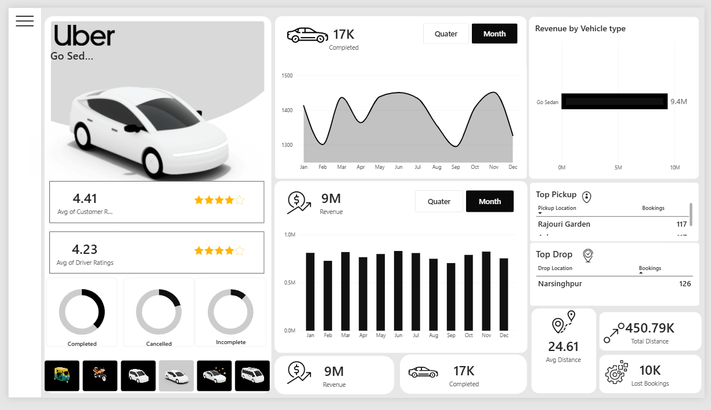
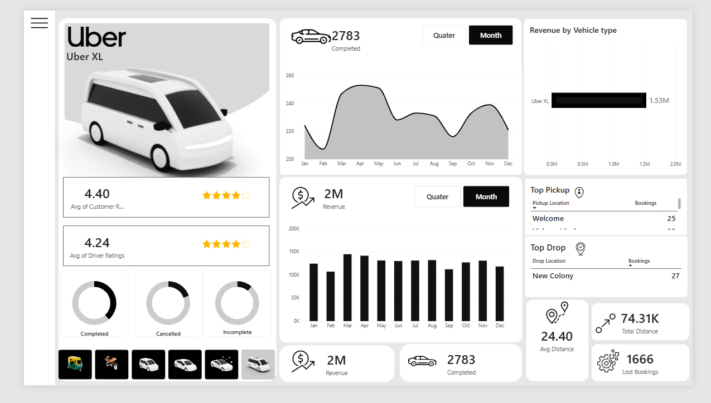

# 🚕 Uber Rides Analysis — Power BI Dashboard

An interactive Power BI dashboard analyzing Uber ride bookings across six vehicle categories — **Auto, Bike, Premier Sedan, Go Mini, Go Sedan, and Uber XL** — covering completed trips, revenue, ratings, pickup/drop hotspots, and lost bookings over a 12-month period.


---

## 📊 Overview

This dashboard breaks down Uber's ride-hailing operations by vehicle type, giving a page-per-vehicle view so performance can be compared side by side. Each page tracks completed rides, revenue trends, customer/driver satisfaction, top pickup and drop locations, and distance-based operational stats.

**Vehicle categories analyzed:**
| Vehicle Type | Completed Rides | Revenue | Avg. Customer Rating | Avg. Driver Rating |
|---|---|---|---|---|
| 🛺 Auto | 23K | ₹13M | 4.40 | 4.23 |
| 🏍️ Bike | 21K | ₹11M | 4.40 | 4.23 |
| 🚗 Go Mini | 19K | ₹10M | 4.40 | 4.23 |
| 🚙 Go Sedan | 17K | ₹9M | 4.41 | 4.23 |
| ✨ Premier Sedan | 11K | ₹6M | 4.40 | 4.23 |
| 🚐 Uber XL | 2,783 | ₹2M | 4.40 | 4.24 |

**Total revenue by vehicle type** (as shown on each page's "Revenue by Vehicle Type" chart) ranges from **₹1.53M (Uber XL)** to **₹12.9M (Auto)**, with Auto and Bike leading overall ride volume and revenue contribution.

---

## 🖥️ Dashboard Pages

Each vehicle type has a dedicated page with an identical layout for easy comparison:

1. **Vehicle Overview Card** — vehicle image, average customer/driver rating, and completed/cancelled/incomplete ride donut charts
2. **Completed Rides Trend** — month-over-month completed rides (Jan–Dec), toggle between Month/Quarter view
3. **Revenue Trend** — monthly revenue bar chart with Month/Quarter toggle
4. **Revenue by Vehicle Type** — comparative bar chart
5. **Top Pickup & Top Drop Locations** — ranked table of highest-traffic pickup/drop points
6. **Operational KPIs** — Avg. Distance, Total Distance, Revenue, Completed Rides, Lost Bookings

### Page-by-page snapshot

| Page | Top Pickup | Top Drop | Avg. Distance | Total Distance | Lost Bookings |
|---|---|---|---|---|---|
| Auto | Kanhaiya Nagar (163) | New Colony (164) | 24.62 km | 625.62K km | 14K |
| Bike | Jahangirpuri (144) | Ashram (149) | 24.76 km | 558.12K km | 12K |
| Premier Sedan | Vaishali (84) | Preet Vihar (89) | 24.60 km | 302.94K km | 6,857 |
| Go Mini | Jasola (134) | Kashmere Gate ISBT (139) | 24.61 km | 501.20K km | 11K |
| Go Sedan | Rajouri Garden (117) | Narsinghpur (126) | 24.61 km | 450.79K km | 10K |
| Uber XL | Welcome (25) | New Colony (27) | 24.40 km | 74.31K km | 1,666 |

---

## 🔍 Key Insights

- **Auto and Bike dominate ride volume**, together accounting for the majority of completed trips — reflecting their role as low-cost, high-frequency options for short urban commutes.
- **Customer ratings are consistently high (4.40–4.41) across all vehicle types**, while driver ratings sit slightly lower (4.23–4.24), suggesting a stable but improvable driver-side experience.
- **Average trip distance is remarkably consistent (~24.4–24.8 km) across every vehicle category**, indicating similar trip patterns regardless of vehicle class.
- **Lost bookings scale roughly with ride volume** — Auto has the highest lost bookings (14K) alongside the highest completed rides, while Uber XL, the lowest-volume category, also has the fewest lost bookings (1,666).
- **Revenue trends show seasonal dips** (notably around February) across most vehicle types, followed by recovery through mid-year.
- Pickup/drop hotspots vary meaningfully by vehicle type — e.g., budget options (Auto, Bike) cluster around dense residential/transit areas (Kanhaiya Nagar, Jahangirpuri), while premium options skew toward different high-demand nodes (Vaishali, Preet Vihar).

---

## 🧰 Tech Stack

- **Power BI Desktop** — data modeling, DAX measures, and report design
- **DAX** — for KPI calculations (completed/cancelled/incomplete rates, revenue aggregation, avg. distance)
- **Power Query** — data cleaning and transformation

---

## 📁 Suggested Repository Structure

```
uber-rides-dashboard/
├── README.md
├── Uber_Rides_Dashboard.pbix
├── data/
│   └── uber_rides_data.csv
└── screenshots/
    ├── auto.png
    ├── bike.png
    ├── luxury_sedan.png
    ├── mini_car.png
    ├── sedan.png
    └── uber_xl.png
```

---

## 📸 Dashboard Gallery

<div align="center">

**Click a vehicle to expand its dashboard view 👇**

<details open>
<summary><b>🛺 Auto</b> — 23K completed · ₹13M revenue · 4.40★</summary>
<br/>

</details>

<details>
<summary><b>🏍️ Bike</b> — 21K completed · ₹11M revenue · 4.40★</summary>
<br/>

</details>

<details>
<summary><b>✨ Premier Sedan</b> — 11K completed · ₹6M revenue · 4.40★</summary>
<br/>

</details>

<details>
<summary><b>🚙 Go Sedan</b> — 17K completed · ₹9M revenue · 4.41★</summary>
<br/>

</details>

<details>
<summary><b>🚐 Uber XL</b> — 2,783 completed · ₹2M revenue · 4.40★</summary>
<br/>

</details>

</div>

> 💡 Every page shares the same layout — vehicle overview, monthly trends, revenue-by-type comparison, top pickup/drop locations, and operational KPIs — so switching between vehicle types feels seamless.

---

## 🚀 How to Use

1. Clone or download this repository.
2. Open `Uber_Rides_Dashboard.pbix` in **Power BI Desktop**.
3. Use the vehicle-type navigation icons on the left of each page to switch between Auto, Bike, Premier Sedan, Go Mini, Go Sedan, and Uber XL views.
4. Toggle **Month/Quarter** on the trend charts to change the time granularity.
5. Hover over chart elements for detailed tooltips.

---

## 👤 Author

**Mohammad Iftequar Uddin**
📧 iftequaruddin220@gmail.com
🔗 [LinkedIn](https://www.linkedin.com/in/iftequar-uddin-316b2a376/) · [GitHub](https://github.com/iftequaruddin220-hue)

---

> ⚠️ **Note:** This dashboard uses sample/demo booking data for analytical and portfolio demonstration purposes.
